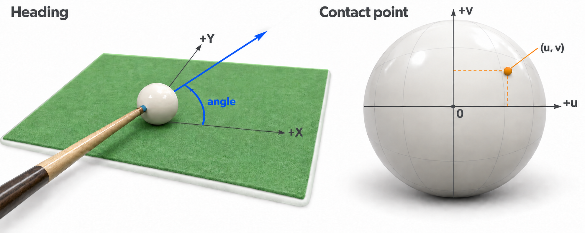

# Snooker MuJoCo 项目
本仓库提供 Snooker 对局环境。在线文档：[简体中文](https://snooker.readthedocs.io/en/latest/)。

## 选手程序限制

比赛决策期间，选手程序不得将当前局面在 MuJoCo 中复制或重建为多个仿真实例，
对不同候选击球进行试打，再根据仿真结果选取最好的一杆。也不得通过反复恢复同一局面，
在单个仿真实例中依次试打来实现同样的搜索。

允许选手程序调用课程环境进行出杆可行性检查。该检查只检测球杆是否会碰到其他球，
不模拟球的运动。

## 安装与运行

使用 Python 3.10 或更高版本。

```bash
conda create -n pool python=3.10
conda activate pool
python -m pip install -r requirements.txt
```

运行两名 player 的对局：

```bash
python scripts/tools/play_snooker_match.py \
  --player-0 'python scripts/tools/snooker_example_player.py' \
  --player-1 'python scripts/tools/snooker_example_player.py'
```

若需录像：

```bash
MUJOCO_GL=egl \
  python scripts/tools/play_snooker_match.py \
    --player-0 'python scripts/tools/snooker_example_player.py' \
    --player-1 'python scripts/tools/snooker_example_player.py' \
    --record outputs/my_match \
    --fps 20
```

每位选手每局使用一个常驻 player 进程，在首次轮到该选手时启动：

1. 选手导入库、加载模型并完成预热后，输出一行 `{"op":"ready"}` 并 flush。
2. 裁判恢复决策计时，将当前状态以一行 JSON 写入选手的标准输入。
3. 选手读取状态，输出击球动作。
4. 环境执行这一杆，更新状态，将新状态发给接下来应击球的 player 的同一进程。

进程启动及就绪前的初始化不占用每回合 120 秒。初始化另有默认 300 秒上限，
可用 `--startup-seconds` 调整；旧版选手需在读取首个状态前增加 `ready` 握手。

选手程序应循环读取状态，每次输出一行 JSON 并 flush，出杆后等待下一次轮到自己，
可在进程内保留本局状态。比赛结束、诊断停止或异常退出时，运行器清理双方进程及其后代。

可加 `--max-shots 2` 完成 2 杆后停止运行，适合快速诊断。实际击球使用较小的物理时间步，完整对局可能耗时较长。

选手从标准输入读取一行 JSON 状态，向标准输出提交 `[angle, speed, u, v]`。`u,v` 是以母球半径归一化的直角坐标，满足 `u²+v²<1`；向右、向上为正。也可输出 `[angle, speed]`，默认击打正中间。日志写入 `stderr`。

<p align="center">
  
</p>

## 渲染 Snooker 场景

```bash
MUJOCO_GL=egl python scripts/render/render_snooker_diagnostics.py --images-only
```

诊断渲染展示球台环境。

## 目录说明


| 目录                 | 内容                                |
| ------------------ | --------------------------------- |
| `src/snooker_env/` | Snooker 状态、规则、player 协议、物理执行及共享依赖 |
| `models/`          | Snooker 球台、球与球杆模型                 |
| `assets/`          | 球杆视觉资源、许可说明及球台来源说明                |
| `scripts/tools/`   | 对局启动、选手示例、物理诊断与校准                 |
| `scripts/render/`  | 渲染脚本                              |
| `scripts/assets/`  | 程序化球台与球模型生成                       |


比赛入口是 `SnookerMatchEnv`。
